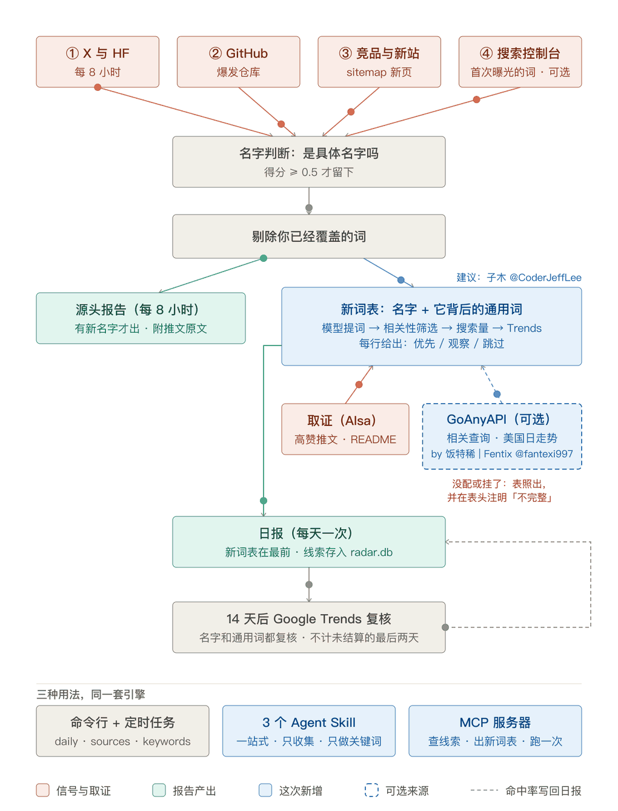

<div align="center">


# new-term-radar（新词雷达）

**AI 圈马上要被搜的新名字，出现当天就抓到，赶在关键词工具收录之前。**

[](https://pypi.org/project/new-term-radar/)
[](https://pypi.org/project/new-term-radar/)
[](LICENSE)
[](https://github.com/zhuyansen/new-term-radar/stargazers)
[](https://github.com/zhuyansen/new-term-radar/network/members)
[](https://pepy.tech/projects/new-term-radar)
[](https://github.com/zhuyansen/new-term-radar/commits/main)

[](https://registry.modelcontextprotocol.io/v0/servers?search=io.github.zhuyansen/new-term-radar)
[](https://tessl.io/registry/skills/github/zhuyansen/new-term-radar)
[](https://lobehub.com/mcp/zhuyansen-new-term-radar)
[](https://agentskillshub.top/skill/zhuyansen/new-term-radar/)
[](https://cursor.directory/plugins/new-term-radar)
[](https://clawhub.ai/skills/new-term-radar)
[](https://skills.sh/zhuyansen/new-term-radar)

⭐ **首日 700+ 星，3 天出头破 1000** · 已上 PyPI、官方 MCP Registry、Cursor Directory、LobeHub、Tessl、ClawHub、skills.sh

[快速开始](#快速开始) · [它读什么](#它读什么) · [新词表](#新词表) · [在 agent 里用](#在-agent-里用skill-和-mcp-服务器) · [config.json](#configjson) · [English](README.md)

</div>

每天一份报告，列出 AI 领域里刚开始冒头的名字：新模型、新产品、新工具、新仓库。在它们最早被说出来的地方抓，而不是等关键词工具里有数据再看。

适合围绕新词做页面、写内容、做产品的人：AI 工具站的 SEO、Newsletter、导航站，或者任何想在「Strata」「Seedance」出现当天就知道、而不是两周后才知道的人。

## 为什么做这个

一个新名字会按这个顺序留下痕迹：

1. 实验室或大号在 X 上先说出来；模型进入 Hugging Face 热门榜。
2. GitHub 上某一个仓库自己涨起来。
3. 导航站和竞品给它加页面；有人为它注册域名，新站开始有排名。
4. 你自己的站第一次因为这个词有了搜索曝光。
5. Google Trends 上出现曲线，这已经是几天到几周之后了。

关键词工具读的是第 5 步。这个雷达每天读第 1 到 4 步，第 5 步只用来复盘自己准不准。

它最初就是照着一个例子做的：[Niko1221/Strata](https://github.com/Niko1221/Strata) 创建于 2026-09-24，九天后 7,700 星。9 月 26 日起就有人在搜「niko strata」，而当时没有第二个仓库用这个名字，关键词工具里也查不到。一个仓库每天涨 800 星，这本身就是全部信号，而且是公开的。

## 它读什么



紫色、标「新增」的是 0.6.0 加的。新词表上：词龄、多市场、首页形态、12 个月走势、你自己的排名、首页上还有什么（讨论帖、AI 概览）、精确匹配的 .com。另外还有：③ 新站最先排上的词，⑦ 求助里 ChatGPT 推荐什么工具，⑧ 多了三家收款平台和建站作品，⑨ 新上架，⑩ 付费信号，以及新名字的旁证。完整列表见 [CHANGELOG.md](CHANGELOG.md)。

| 信号 | 抓什么 | 需要 | 花费 |
|---|---|---|---|
| ① X | 你关注的账号里，60 天内第一次出现的名字 | AIsa key | 每个账号每次 $0.003 |
| ① Hugging Face | 新进热门榜前 50 的模型和 Space（大家实际在试的 demo）；量化版、微调版和模型自己的 demo 归到同一个基础名下 | 无 | 免费 |
| ② GitHub 爆发 | 创建不到 14 天、平均每天涨 200 星以上，或比昨天多 400 星的仓库；附带大家实际会搜的写法（「niko strata」） | 无（有 GitHub token 限额更高） | 免费 |
| ③ 竞品 sitemap | 某个站新增的几个网址共用、而它的旧网址里很少出现的词。示例配置盯着 8 个 AI 工具导航站（toolify、aixploria、ai-bot.cn、opentools、dang.ai、clipfly、aitoptools、futurepedia）和 4 个 MCP、skill 目录 | 你列出的 sitemap | 免费 |
| ③ 新站 | 近 90 天注册且首次被收录、已经有 20 个以上排名词的域名；每个新出现的站附上它最先排进 Google 前 20 的词，不限国家：这么新的站已经够得着的搜索 | AIsa key | 每个查询约 $0.13，每周一次；每个新站查词约 $0.013 |
| ⑦ 求助 | Reddit 上大家在要什么（"is there an AI tool that…" 等 12 种问法），还有 X、Stack Exchange（Software Recommendations 等 4 个站）和 Freelancer.com 上的：模型留下 AI 工具能解决的求助和抱怨，把每件事写成大家会搜的说法；有搜索量的再做首页竞争检查 | AIsa key | 每周约 $0.12，X 另加几美分 |
| ⑧ 新卖家 | 刚挂上第一条收款链接的站（Stripe Payment Links、Polar、Lemon Squeezy、Gumroad、Creem、Paddle、Dodo Payments、Waffo Pancake），来自公开外链数据，带这个站第一次挂链接的日期；老卖家的新页面、平台上的用户页、论坛，以及好几个新站共用的同一条链接（站群）都不算；站点自己的介绍交给新词表，有 GoAnyAPI 时还有访问量、域名注册日期和访客来源（含 AI 占比） | AIsa key；GoAnyAPI 可选 | 每周约 $0.50 |
| ⑧b 新作品 | 刚用 Lovable、v0 做出来的站，刚在 beehiiv 开张的 newsletter，从它们挂的徽章认出来；只有其中的软件才进线索 | AIsa key | 每周约 $0.15 |
| ⑨ 新上架 | Product Hunt、Show HN、OpenRouter、Civitai、App Store 畅销榜和 awesome 列表上的新条目（免费）；每周一次：Google 新收录的 Figma 插件、There's An AI For That、Chrome 应用商店页面，抖音、TikTok、Reddit 热搜，以及词根旁边正在上升的搜索（"ai generator"） | 免费列表不用 key；其余要 AIsa 和 GoAnyAPI 的 key | 免费；每个路径约 $0.02，每份热搜 $0.001，每个词根 6 个 GoAnyAPI 积分 |
| ⑩ 付费信号 | 一个付费工具站的 AdSense 账户名下的其他站（站长的其他赛道），以及你关注的词上新出现的广告主（Google 广告透明度中心） | GoAnyAPI key | 每个站双向各 3 积分，每个词 4 积分；每周一次 |
| 新名字的旁证 | 当天最强的几个新名字：带这个名字的新域名（whois，或 crt.sh 的新证书）、维基百科浏览量、Google 把它认作什么、Discord 服务器；付费产品则查「alternative」「vs」「free」「pricing」「review」这些搜索 | AIsa key；Discord 要 GoAnyAPI | whois 每个名字约 $0.12，搜索量 $0.09 |
| ⑥ 收入 | 有人付钱的产品，来自 TrustMRR 核验过的收入：增长最快的（30 天收入 $500 以上）和最新上榜的；上次 $0、这次过了门槛的排最前。它自己的介绍会作为依据交给新词表 | TrustMRR key | 免费，6 次请求，每周一次 |
| ④ Search Console | 你的站第一次获得曝光的查询词（用新鲜数据） | 你自己的 Google 授权 | 免费 |
| ⑤ 复盘 | 每条线索 14 天后去 DataForSEO Trends 核对，和它自己的基线比；按信号统计命中率和提前天数 | AIsa key | 每个搜索写法 $0.0012 |
| 新词表 | 针对当天的新名字:找出它背后的通用搜索词(大家拿这个新东西做什么),逐个估算规模、看首页还有没有位置,并给出决策 | AIsa key；[GoAnyAPI](https://goanyapi.com) key 可选 | 5 个名字约每天 $0.18，加上 GoAnyAPI 约 $0.30 |
| 名字判断 | 小模型给每个词打分：是某个具体东西的名字，还是普通词？ | AIsa key | 每次不到一美分 |

价格是 2026 年 10 月 AIsa 的实际收费。按示例配置（35 个 X 账号、每天读三次，新词表每天读 5 个名字），一个月约 $15：读 X 约 $10，新词表约 $5。少读几个账号或者每天只读一次，费用按比例下降。

## 新词表

只有名字是不够的。「SynthID Detector」作为关键词寿命短，而且是 Google 的；它做的那件事「ai image detector」才是大家会一直搜的词，而且不属于任何人。雷达每天会把新名字再读一遍，把两种词写进同一张表：

```
| 关键词 | 类型 | 来自 | 新词? | 估算日搜 | 开始上涨 | 峰值 vs gpts | 峰值日 | 近 7 天比前 7 天 | 现在 | 首次有搜索 | 市场(月搜/KD) | 首页竞争 | 首页结构 | 决策 |
| **photocraft** 🖼 | 名字 | — | 是 | 12747 | 2026-10-05 | 97 vs 3.1 | 2026-10-09 | — | 还在涨 | 2026-10-04 🆕 | **最佳 US** · US 110/0 · DE 20/0 · FR 20/0 · JP 10/31 | — | 可超越 · 1 首页 / 6 内页 · 2 平台 · 标题含原词 ×6 | **优先** |
| **ai image detector** 🖼 | 通用词 | synthid detector | 否 | 2537 | — | 87 vs 31.6 | 2026-10-04 | ×1.2 | 没动 | 2023-02-19 | **最佳 US** · US 74k/37 · DE 3.6k/48 · FR 2.9k/47 · JP 720/31 | — | — | 观察 |
| **photoshop alternative** ⚠ | 通用词 | photocraft | 否 | 244 | — | 61 vs 61.7 | 2026-10-08 | ×1.8 | 没动 | — | — | — | — | 跳过 |
```

（2026-10-12 一次真实运行的节选；「首页竞争」一列是后来加的，「首次有搜索」「市场」「首页结构」是 0.6.0 加的，取自 2026-10-18 的一次运行，见下。0.6.0 还在「现在」后面加了「近 12 个月」一列，决策后面加了动作：`→ 更新现有页`、`→ 改进现有页` 或 `→ 新建页面`，见下面 10 到 13。）

它是怎么做出来的（`radar/usecases.py`）：

1. **取证**：搜提到这个名字的高赞帖子（X 高级搜索）；如果是仓库，再读它的 README。
2. **提词**：模型读完证据，针对它看到的每一种用法，写出普通人会搜的关键词，并附上原话作依据。借别的产品名字的写法（「photoshop alternative」）会保留并标 ⚠：需求常常挂在老牌产品上，要不要用别人的品牌由你判断。
   如果配了 GoAnyAPI 的 key（可选，见下），雷达还会取这个名字在 **Google Trends 里的相关查询**：大家实际把什么词和它一起搜。SynthID Detector 拿到的是「ai photo detector」「google ai detector」「ai detector」，这些行带 🔎。包含名字本身的查询列为它的长尾（「photocraft download」「nano banana 2.1 vs pro」）。本身是别的新东西名字的查询（「nano banana 2.1」旁边的「gpt image 2.5」）单独记为线索。
3. **筛选**：再调一次模型，给每个写法打分：这个名字能不能回答这个搜索；同时标出品牌、认出别的东西的名字。关系不够直接的丢掉。Claude Haiku 5.5 提出的 6 个全被筛掉（「ai coding assistant」「github copilot alternative」）；SynthID Detector 的 5 个全部保留。
4. **搜索量**：一次批量查询，取剩下写法的 Google Ads 月搜索量。低于 `min_volume` 的丢掉，大部分都会被丢掉。
5. **Trends**，每行查两次：单独查这个词，得到曲线形状（是不是新词、哪天开始涨、峰值、近 7 天比前 7 天、现在的走势）；和基准词（默认 `gpts`）放在一起查，得到规模。
6. **首页竞争**，只查会被采取行动的行（最多 8 行）：Google 第一页（每词约 $0.002）、第一页上每个站的评分（GoAnyAPI，每站 $0.002，保留 30 天）和关键词难度（每次 $0.012）。有 GoAnyAPI key 时，还会看谁已经在为这个词做东西、谁在为它付钱：近一个月标题里带这个词的页面数（「已有页面」）和在这个词上投谷歌广告的域名（「在投广告」，来自广告透明度），每行 $0.008。`能进` = 前十里有 3 个以上评分低于 30 的站，或难度低于 20；`挤满` = 一个弱站都没有、难度 40 以上；其余为 `一般`。表下面会列出首页最弱的那个站（新页面最容易挤进去的位置），以及首页由哪类页面构成（工具、榜单、文章、视频、论坛）。首页有广告，说明有人在花钱买这个点击。只记录、不参与判断（report.json 里的 `page_age`）：第一页上的站分别是什么时候注册的（RDAP 查注册日期，免费），以及和上一次读这个词相比新进前十的结果，留着以后验证「第一页上有新站的词，新站是不是更容易进」。

7. **词龄**，只查「优先」和「观察」的行：取这个词 5 年的 Trends 热度（每周一个点），第一个有热度的那一周就是「首次有搜索」，180 天以内的标 🆕。新词的首页竞争放宽一档读（挤满 → 一般，一般 → 能进）：难度分数和站点评分都是按为别的东西写的页面算的，跟不上半年前还没人搜的词。还没过完的那一周和 Trends 没结算的最后两天不计，所以「0, 100」这种尾巴不会让老词看起来像新词。每行一次 Trends 查询，$0.0012。由老词拼成的词（「nano banana」在 2021 年就有一点热度）会按那些更早的搜索来定年龄。
8. **市场**，同样只查这些行：`markets.codes` 里每个市场（默认 US、DE、FR、JP，不限语言）的 Google Ads 月搜索量，`difficulty` 打开时还有当地的关键词难度，压成一格：`最佳 DE · US 5k/50 · DE 900/5 · FR 300 · JP 0 · 热度最高 Germany`。`最佳` = 所有有搜索量的市场都有难度时，按每点难度对应的搜索量选；否则按搜索量选。`热度最高` = Trends 热度最高的国家，只在主要市场里选（Trends 量的是当地搜索的占比，不加限制会把荷属圣马丁排第一）。默认配置每次约 $0.41（每个市场一次 $0.09 的搜索量查询，难度每次约 $0.012），热度最高国家每行另加 $0.0024。
9. **首页结构**，只查「优先」的行：实时前十（默认 US / en / 桌面；首页竞争那一步已经查过就直接复用，通常不额外花钱，否则每词约 $0.002），看首页和内页各几个、有几个在高权重平台上（`serp_shape.platforms`：github.com、medium.com、sites.google.com、`*.github.io`、reddit.com、youtube.com、wikipedia.org）、标题里含关键词的有几个。`平台占据` = 一半以上在平台上；`可超越` = 大多是内页，且没有精确匹配的首页（标题含这个词、或域名就是这个词的首页）；其余为 `有争夺`。表下面列出第 1、2 名的网址和标题。

三项都可以在各自的配置块里设 `"enabled": false` 关掉。2026-10-18 对「photocraft」（优先）和「ai image detector」（观察）实测：首次有搜索分别是 2026-10-04 🆕 和 2023-02-19；两者最佳市场都是 US（「ai image detector」月搜 7.4 万、KD 37）；「photocraft」的首页结构是 `可超越 · 1 首页 / 6 内页 · 2 平台 · 标题含原词 ×6`，第 1 名是它的 GitHub 仓库。这次花了 $0.42。

0.6.0 还加了四项读数，都不额外花钱：读的是搜索量查询和首页竞争检查已经拿回来的数据、你自己的 Search Console，以及 .com 的注册局。

10. **近 12 个月**（`year_curve`），所有有 Google Ads 数据的行：搜索量查询本来就带着每个词最近 12 个月的数据。这一列按这个词自己的最高月、从零画成柱，再加一句话：`X 起才有`（一年前几乎没人搜）、`冲高`（已过顶的爆发：峰值是中位月份的 2 倍以上，现在只剩一半以下）、`下降`、`上升`（最近三个月对比之前三个月，±30%）或 `平稳`；最高的一个月不到 50 就写 `搜索太少`，因为 Google Ads 会把小数字取整。最新一个月大约晚一到两个月。2026-10-20 实测：「claude skills」是 `2026-03 冲高，现在 -80%`（最高每月 90,500，2026-09 只有 18,100），「best claude skills」是 `2026-01 起才有 · 下降，6 个月 -47%`，「skill md」是 `平稳`。
11. **你的排名**（`yours`），只查「优先」和「观察」的行：在首页竞争检查拿到的前十里找你的站（`yours.domains`，不填就用 `gsc.site` 那个 Search Console 资源的域名）；配了 `gsc` 的话再查 Search Console（这个词 28 天的平均排名、展示和点击，所有行一次查完）。决策格随后写出该做什么：`→ 更新现有页`（任一来源显示你在首页）、`→ 改进现有页`（Search Console 平均 11 到 30 名）、`→ 新建页面`（没找到，或排得更靠后），表下面列出你已有的页面。一个正在涨、你已经有排名的词，该做的是更新，不是新建。2026-10-20 实测：我们的一个站在一个词上平均第 23.5（改进那一页），在另一个词上是首页排第 89、只有 1 次展示（新建页面）。
12. **首页上还有什么**，来自首页竞争检查：「首页竞争」那一格现在会标出 AI 概览、答案框、论坛模块、视频或新闻；表下面列出首页上的论坛帖，best 类搜索排前面：在那里回答能直接触达搜这个词的人。Google 给出 AI 摘要时，用户点结果的比例大约减半（皮尤研究中心 2025：8% 对 15%）。2026-10-20 查的 5 个「claude skills」相关词，首页全都有 AI 概览。
13. **精确匹配的 .com**（`dot_com`），只查「优先」的行，名字优先：把连写和连字符两种写法拿去问注册局的 RDAP（Verisign），免费。未注册不等于能按常价买到：有些名字被注册商保留，或按溢价出售。2026-10-20 实测 5 个「claude skills」相关词的 10 种写法，只有一个没被注册。

每项都有自己的配置块和 `"enabled"` 开关；首页上的标记跟着首页竞争检查一起出。2026-10-20 实测 5 个词一共花了 $0.11，就是搜索量查询和首页竞争检查的钱。

日搜是估算值。通用词用它自己的 Google Ads 月搜索量，沿它自己的 Trends 曲线推到今天。再用这些词反推出基准词的规模，名字还没有搜索量数据，就对比基准词来估。

决策：**优先** = 近 30 天涨过、现在还在高位、估算日搜不低于 `min_daily`。**观察** = 涨了但规模小，或还太早读不出，或没动但本身有这个规模的稳定需求。**跳过** = 已回落，或没动且规模小。

首页 `挤满` 的 **优先** 会降成 **观察 ↓**：还在涨，但首页被强站占满。新名字第一周的首页还在成形（新闻、官方页），以三天后第二次读到的为准。

标记：🎬 视频、🎙 语音、🖼 图片 说明它产出什么，一般用户愿意付费的顺序是 视频 > 语音 > 图片 > 文字；同等条件的线索按这个排序。⚡ = 有 1,000 赞以上的帖子在手把手讲一套手动流程，或在跟一个热梗：还没人做成一键工具。两者都是按关键词规则从线索自己的字句和帖子里读出来的；在 6 个已知名字上（Nano Banana、Veo 3.1、Seedance 2.5、Claude Opus 5.5、ElevenLabs v4、Qwen Image 2.1）格式 6 个全对，⚡ 只触发一次，是一条被大量转发的 Opus 5.5 + Blender + Unreal 教程。按标记行动前先读原帖。

每个名字读两次：出现当天一次，三天后一次。因为发布当天的帖子都是公告，还看不出用法。通用词也会记进线索库，14 天后和名字一起复盘。

从我们最早跑的 8 个名字看，对它应该有这样的预期：

- **名字涨了；通用词在五天内大多没涨。** PhotoCraft、Claude Haiku 5.5、SynthID Detector 的搜索都明显上升。它们背后的通用词里有一个动了：PhotoCraft 出现后，「photoshop alternative」在美国连续五天比之前高出约 80%。这张表读的全球日数据几乎没反映出来（2、1、1、2、4、2），而另一个来源的美国日数据看得很清楚。所以全球数据显示「没动」，不能证明这个词真的没动。配了 GoAnyAPI 的 key 后，规模较大的行改读单个国家的数据，在那份数据里比之前高 50% 且持续三天算上涨；同一次运行里「photoshop alternative」就显示为 `还在涨 (US)`。
- 这张表今天靠得住的用处，是告诉你**一个新东西对应的是哪个已有需求、这个需求有多大**（「ai image detector」约每天 2,500 次搜索）。通用词会不会跟着名字涨，要等 14 天复盘才知道，我们现在还没有结果。
- 对纯模型发布（Claude Haiku 5.5、Nano Banana 2.1），证据都是公告和跑分，提出来的词很弱（「ai coding assistant」）。对只做一件事的产品和仓库效果更好。
- **全球 Trends 曲线最后两天的数据没有结算。** 互不相关的词在这两天会依次返回 0 和 100，看起来像一个尖峰。我们第一遍就是被这个骗了；现在代码里所有读 Trends 的地方都会丢掉这两天，而且上涨必须持续两天才算数。
- Google Ads 的搜索量滞后约两个月。月搜只有几百的词，Trends 基本读不出可靠的数。

### 某个数据源没配或挂了的时候

表照常产出，但会变薄，并且会写明缺了哪一块：

| 情况 | 表里少了什么 | 表下面会出现的一行 |
|---|---|---|
| 没配 `GOANYAPI_API_KEY`（默认就是这样） | 没有 🔎 行、没有名字的长尾、没有「一起被搜的其他名字」、没有 `(US)` 走势。通用词只来自模型，走势全部读全球数据，真实的上涨可能被读成「没动」 | 「相关查询未开启：设置 GOANYAPI_API_KEY 后…」 |
| GoAnyAPI 的 Trends 挂了（接入第一天 2026-10-12 就遇到过） | 这一次运行等同于没配 key | 「相关查询失败：…」和「国家数据获取失败，已退回全球数据：…」 |
| 某个名字的 AIsa 推文搜索失败（2026-10-13 遇到两次超时） | 这个名字的推文证据。仓库还有 README 可用；没有 README 的模型或产品就只剩相关查询，如果又没配 GoAnyAPI，这一天它就没有通用词 | 「推文搜索失败，这次只用了 README 和相关查询：…」 |
| 某个名字既没有推文也没有 README | 它的通用词；名字自己那一行还在 | 「没找到帖子或 README：…」 |
| 当天没有名字得分 0.8 以上的「东西」类线索 | 整张表 | 「今天没有要读的名字…」 |
| AIsa 的搜索量或 Trends 查询失败 | 整张表：这两项没有替代来源 | 表的位置直接显示报错 |

表变薄不等于今天没动静。下结论说「什么都没涨」之前，先看表下面这几行。

把配置写成 `"usecases": {"per_day": 0}`，或者加 `--skip usecases`，可以关掉它。

### ⑥ 收入：大家已经在付钱的东西

一个能赚钱的产品，证明了它背后的需求。设置 `TRUSTMRR_API_KEY`（在 TrustMRR 的开发者后台生成）后，雷达每周读一次（`revenue.weekday`，默认周一）：近 30 天收入至少 `min_revenue_usd`（$500）、增长最快的 30 个产品，以及最新上榜的 30 个，并记下这次看到的。最新上榜的大多还几乎没收入，读它们是为了记下起点：上次 $0、这次过了门槛的产品会排在最前。隐藏的条目（"Anonymous startup"）不算；公司全称会换成网站名（"Talent Tech Global Limited" 读作 gptproto）。每个产品自己的介绍会作为依据交给新词表，于是新词表读出的是大家付钱买的那件事，而不只是品牌名。增长超过 1,000% 的显示为「从接近 $0 涨起来」：第一次运行时，增长最快的大多是从几乎为零起步的。

TrustMRR 的 API 条款禁止转载它的数据，也禁止拿它做公开的 SEO 页面。这些线索只供你自己研究，不要公开这份清单。

### ⑦ 求助：大家直接说出来的需求

雷达每周在 Reddit 上按十来种求工具的问法搜一次（"is there an AI tool"、"I wish there was a tool"、"how do I automate" 等，见 `asks.patterns`），留下最近一周、得分 2 以上的帖子，让一个小模型分类：求助、抱怨、分享的解法，或其他。对 AI 工具能解决的求助和抱怨，它把要做的事写成大家会搜的说法（"add b roll automatically"、"convert slides to notes"）。月搜索量 50 以上的列出来，附上帖子并做首页竞争检查，每件事记为一条线索。大多数求助太具体，还没有搜索量：第一次真实运行，一周 84 个帖子里有 43 个求助，只有两个月搜索量过 50（"best ai tool for research"，来自 r/PhD 一个 1,034 分的帖子；以及 "best ai tool for coding"）。所以其余得分最高的也会单独列出来，作为点子而不是关键词。试跑时读一个月的帖子，找到了「有没有 AI 工具能把 PPT 课件转成笔记」——正是一门工具站课程拿来做示范的那个需求。

打开 `ai_answers`（默认关；每个回答约 $0.004）后，有搜索量的需求还会拿去问 ChatGPT（用 DataForSEO 的 LLM 抓取，拿到的是 ChatGPT 自己界面带搜索时给的回答）；设成 `"engines": ["chatgpt", "google"]` 还会问 Google 的 AI Mode。问法是「What is the best tool to {job}?」。表里多一列写回答点名了哪些工具，表下面列出它们引用的站，引用了你的站会标 ✅。没点名任何工具 = AI 搜索里的空位，新工具可以去占；被引用的站 = AI 搜索读的就是这些页面：争取被它们收录，或者写和它们的对比页。2026-10-20 实测「convert powerpoint slides to notes」：ChatGPT 点名 Google NotebookLM、ChatGPT 和 Microsoft Copilot，AI Mode 列出 Knowt、NoteGPT、Microsoft Copilot 等。

帖子只供自己研究：可以引用，不要转载。

### ⑧ 新卖家：谁刚开始收钱

一个产品挂出第一条收款链接，比发布帖更说明问题：有人做了东西，并开口要钱。whoismaking.money 曾经按「往 Stripe 结账页送了多少流量」给网站排名（点击流数据；互联网档案馆里它最后一个真实页面是 2025 年 9 月的，到 2026 年 3 月域名已是带隐藏跳转的停放页）。同类数据通过 AIsa 的 Similarweb 买得到，但每 20 行约 $6，覆盖不了长尾。收款链接是便宜的替代：它们是卖家自己页面上的普通链接，公开外链数据里查得到，还带每条首次出现的日期。Stripe 有 14.3 万个站链着它，Polar 1,900 个（每条都是收款链接）；Lemon Squeezy、Gumroad、Creem 只算店铺结账页、`/l/` 商品页和 `/payment/` 页，因为它们其余的链接指向自己的官网，Gumroad 还有大量被垃圾外链网络利用的个人主页。

雷达每周对每个平台读最新的 100 条收款链接，和最新的 100 个第一次链到这个平台的站（每个平台约 $0.06），只留这些新站的链接，列出它们的访问量（GoAnyAPI）和首页自己的标题、介绍，介绍同时交给新词表当依据。第一次真实运行，排在最前面的是 janitorai.com、framer.com、pub.dev、Flathub 和一个 n8n 论坛帖：都是大平台上的用户页，链着别人的收款链接。所以现在要求链接所在的页面是这个站自己的首页、价格页或产品页，不能是帖子、话题或列表页；站点在 DataForSEO 0 到 1,000 的评分里不超过 350；月访问超过 30 万的算平台。然后由一个小模型根据各站自己的介绍按类型分好（调用失败时用关键词规则），AI 和软件排最前，然后是模板、课程和其他；同一类里访问量大的在前。第一次按类型排序，列出的 12 个全是软件（其中有 Mac 实时字幕、和 PDF 对话的工具、macOS 上的 AI 写作 app、一个 MCP 目录、一个日本的内控审计 SaaS），而只按访问量排时，排在前面的是 Blender 插件站、食谱博客和设计图库。有收款链接只说明它在卖，不说明卖得好；付款时才由代码生成的结账页看不到。

新链接不等于新卖家。最初的版本把最新的链接当成新卖家；2026-10-14 我们按「这个站第一次链到这个平台的日期」核对了一遍：卖了好几年的站，每做一个新页面都会挂上同一条链接（有个站在它的每个水井许可证页面上都挂着同一条 Stripe 链接），最新的 2,000 条 Stripe 链接里有三分之二来自这样的站；当天名单上的 60 个 Stripe 卖家，只有 17 个是真的刚开始。所以现在按这个站第一次链到平台的日期判断新卖家（DataForSEO 的 referring domains），报告里也会写出有多少条链接来自老卖家。

### 历史：2019 年以来的全部卖家

```bash
python -m radar history pull            # 今天还链着这五个平台的所有站：约 $18
python -m radar history read            # 读它们首页的标题和介绍，免费
python -m radar history sort            # 小模型按类型分：每 60 个站约 $0.005（--rules：只按关键词规则，免费）
python -m radar history update          # 每周一次：补上最新一天之后出现的卖家，约 $0.5
python -m radar history --out sellers.csv
```

`history pull` 读今天链着每个平台的所有站，每个站一行，带它第一次挂链接的日期：用 DataForSEO 每个域名取一条的外链，从最早的排起，每次 1,000 条（$0.06）。2026-10-14 核对过：两份名单写法相同的 1,704 个 Polar 站，这个日期和 referring domains 记录的首次日期全部一致。花到 `--max-usd`（默认 20）就停，下次从停下的地方接着拉。只跑 `history` 会按月份、平台、类型统计卖家数；加 `--out` 把全部卖家写进 CSV。这些数据来自 DataForSEO：只用于研究，不要转载发布。

能追溯多久，看外链数据里每月第一次链到平台的站数（2026-10-14；每个平台一次调用，$0.03）：

| 平台 | 从何时有量 | 2019 年以来累计 | 2026 年 5 到 9 月每月新站 | 今天还链着 |
|---|---|---|---|---|
| Stripe | 2021 年 6 月（之前每月几十个以内） | 30.6 万 | 6,500 到 8,200（6 月 1.42 万） | 14.3 万 |
| Gumroad | 2019 年 | 53 万 | 4,200 到 5,700，同时每月有 6,400 到 9,400 个站撤掉链接 | 14.0 万 |
| Lemon Squeezy | 2023 年 | 3.4 万 | 600 到 1,100 | 1.8 万 |
| Polar | 2024 年 | 2,285 | 109 到 268 | 1,943 |
| Creem | 2025 年 | 1,708 | 74 到 268 | 1,449 |

看这张表要注意两点。2023 年 10 月 Stripe 从 3,216 跳到 16,206，下个月新外链从 120 万涨到 2,000 万：是爬虫扩大了，不是卖家暴增。另外拉下来的只有今天还链着的站，月份越早，缺的卖家越多。Gumroad、Lemon Squeezy、Creem 的月度数字还包括指向它们官网和个人主页的链接；拉取时会分开（只有收款链接算卖家）。

### ⑧b、⑨、⑩ 和新名字的旁证

- **⑧b 新作品**（每周，跟 ⑧ 一起）：AI 建站工具挂在作品上的徽章（「Edit with Lovable」「Built with v0」）和新 newsletter 的「Powered by beehiiv」链接，从同一份外链数据里读。用建站工具做的大多是小商家的网站（披萨店、草坪养护）；只有其中的软件进线索，其余的只说明这个工具被拿来做什么。
- **⑨ 新上架**（每天；付费的每周）：每份列表里雷达上次读过之后新出现的条目（第一次运行只建快照，并列出来源自己标明是近期的条目）。Figma、There's An AI For That、Chrome 应用商店本身不去读，读的是 Google 对它们新页面的收录。
- **⑩ 付费信号**（每周，GoAnyAPI）：靠广告赚钱的站会在 ads.txt 里写出自己的 AdSense ID，同一个 ID 出现在别的域名上，就是同一个站长的其他站，每个都是有人已经赚到钱的细分赛道。查的是当天值得做的词首页上的工具站，以及 ⑥、⑧ 里的付费产品。你在 `ad_terms` 里关注的词上出现了新广告主，说明有人刚认定这个词值得花钱。
- **新名字的旁证**：大家会在搜索引擎收录之前就注册带新名字的站，所以看带这个名字的最新域名（前两个名字用 whois，其余看新签发的 HTTPS 证书）、维基百科本周和上周的浏览量、Google 自己给它的类型（「AI agent」说明 Google 已经认识它；Google 只认得别的东西，就是撞名了）和相关的 Discord 服务器。付费产品的「替代品、对比、价格」这些搜索，是有人已经验证过的市场。

### ⚡ 教程观众在要什么

对每天最多 3 条带 ⚡ 的线索（一条被大量转发的手动流程教程），雷达找出它的热门教程视频（GoAnyAPI），读视频下的评论（AIsa，每页 $0.001），让模型挑出观众在要什么：哪一步太难、「能不能一键搞定」。这张清单就是那个一键工具。找视频需要 GoAnyAPI key。

## 痛点：`python -m radar pains "ai headshot"`

把大家对一类工具的抱怨，归纳成新工具能填的缺口：

- Google 上这个词对应的 Chrome 扩展的低星评论（1 到 3 星），或你用 `--extension ID` 指定的扩展（GoAnyAPI：找扩展 2 credits，每页评论 3 credits）；
- Reddit 上抱怨这件事或相关工具的帖子（"{关键词} alternative"、"{关键词} frustrating" 等；AIsa）；
- 这个词的热门教程视频下的评论（AIsa）。

模型把它们归成缺口（缺功能、太难、质量、价格、想要工具），每个缺口给出次数、例子和有这个问题的人会搜的说法。每个词约 $0.05。次数是读到的条目数，不代表市场规模。

读不到的：App Store、Google Play、Trustpilot 的评论（DataForSEO 是「先提交、后取结果」的任务接口，AIsa 只支持同步调用）；There's An AI For That 的求助板（每个页面前都有 Cloudflare 挑战，硬闯就是绕过对方的反爬，雷达不做）；Facebook 小组（Meta 2024 年 4 月关闭了 Groups API，它的研究数据库只对获批的学术和非营利研究者开放）。

## 一个必需的 key，一个可选的

所有付费的部分都走 [AIsa](https://go.aisa.one/yansen-zhu)：X 帖子、DataForSEO Trends（DataForSEO 对 Google 搜索热度的估算，不是 Google Trends 本身）和域名数据、判断名字的模型。一个 key，按次付费，不用分别订阅 X API 和 DataForSEO。

> 上面是推荐链接：通过它注册是对这个项目的支持。从 aisa.one 任何入口拿到的 key 用起来完全一样。

**可选：`GOANYAPI_API_KEY`**（[goanyapi.com](https://goanyapi.com/r/ga-95708898fb)）从两方面改进新词表，每天约 $0.07：给每个名字加上 Google Trends 的相关查询；名字和规模较大的通用词（月搜 1,000 以上，最多 8 行）的走势，改用单个国家的 30 天日数据来读，这份数据结算到昨天。这些行的「现在」一列后面会标出国家，例如 `还在涨 (US)`。不配这个 key，新词表只用模型提出的写法和全球数据。这个服务很新（2026 年 8 月才发布）；我们测试时每次调用要 20 到 55 秒，大约十次有一次失败，所以雷达会试两次，失败就写在表里，继续往下跑。上面这个也是推荐链接。

没有 AIsa 的 key 时，免费的信号照常运行（Hugging Face、GitHub、sitemap、Search Console），只是报告里所有词不分先后列出，因为没有模型判断哪些是名字。

## 快速开始

需要 Python 3.10 或更高版本。雷达本身只用标准库。

```bash
git clone https://github.com/zhuyansen/new-term-radar
cd new-term-radar
cp config.example.json config.json      # 然后编辑：你的 X 账号、sitemap、主题；想要中文报告把 lang 改成 "zh"
export AISA_API_KEY=...                 # 从 https://go.aisa.one/yansen-zhu 获取；用 AIsa 命令行 `aisa login` 登录过也可以
python -m radar daily --out report.md
```

第一次运行只是建立快照：昨天的 X 词表、星数、sitemap 网址都还没有，所以只会报出 GitHub 爆发仓库（它不依赖昨天的数据）。从第二次运行起，每个信号都会报告变化。

两个命令：

```bash
python -m radar sources --out sources.md           # 只跑 ①：X 和 Hugging Face，每隔几小时跑一次
python -m radar daily --skip x,hf --out report.md  # 其余全部，每天一次
```

`sources` 只在有新名字时才写报告。`daily` 带 `--skip x,hf` 时，会列出 `sources` 在过去 24 小时记下的线索。如果你每天只跑一次，直接用 `python -m radar daily`，什么都不跳过。

其他参数：`--skip` 可选 `x,hf,breakout,sitemaps,newsites,gsc,review,judge,usecases`；`--new-sites` 让每周信号今天就跑；`--mail` 发邮件（见下）；`--state DIR` 指定数据库和快照的目录。

需要查看每一步如何运行时，加 `--verbose`；用 `--log-file` 保存完整过程：

```bash
python -m radar daily --out report.md --verbose --log-file state/run.log
```

日志显示各信号的开始、结束、耗时、跳过/失败、首次快照、抓取和筛选数量、GitHub 逐仓库计算、sitemap 重试和快照读写，以及候选合并和入库结果。日志输出到 stderr，报告仍输出到 stdout；日志文件使用 UTF-8、追加写入，父目录会自动创建。不加这两个参数时保持原来的输出方式。

结合代码理解设计和本机首次运行结果，见 [运行原理与首次运行](docs/RUNNING.zh-CN.md)。

## 报告长什么样

2026-10-12 一次真实运行的节选（中文报告，`"lang": "zh"`）：

```
### 候选新词(判为专有名词的排前面;已覆盖的会标出)

| 词 | 信号 | 名字得分 | 已覆盖 | 搜索变体 | 例子 |
| **gridcraft** | GitHub 爆发 storytold/gridcraft ★3178(均 626/天) | 0.95 | 无 | storytold gridcraft | GridCraft: an open-source, cl… |
| **artex** | GitHub 爆发 mhtsec/ARTEX ★3353(均 825/天) | 0.85 | 无 | mhtsec artex, mht artex | AI 自主渗透测试系统 … |

其他上升词(判为普通词):anatomy, math, iphone use

### ⑤ 复盘(14 天前报出的词,在 DataForSEO Trends 里起没起来)

| 词 | 首次报出 | 结论 | 提前天数 |
| strata | 2026-09-25 | hit | 3 |
```

`daily` 还会在 Markdown 旁边写一份 `report.json`，包含生成报告用到的全部数据。

## config.json

| 字段 | 含义 |
|---|---|
| `lang` | `"en"` 或 `"zh"`：报告的语言 |
| `x_accounts` | `labs` 和 `bloggers`：要读的 X 账号。实验室最先说出名字；博主选你这个领域里新词靠谁传开 |
| `sitemaps` | 想看哪些站新增了什么页面。`index` 是一个 sitemap；如果它是 sitemap 索引，用 `shards`（正则）挑要读的子 sitemap。`pause` 是对这个站两次请求之间的秒数。`strip_locale` 去掉 `/en/`、`/zh-CN/` 这类前缀，同一条目的多语言版本只算一次 |
| `topics` | 名称和正则：每个主题单独一节，列出匹配的线索、仓库和查询 |
| `known_terms` | 你已经有页面的词，或者永远不想看到的词。包含它或被它包含的线索会被标出，不进入复盘 |
| `stop_words` | 你这个领域的日常用词，追加到内置列表（内置列表是按 AI 工具领域调的） |
| `judge` | `model`（AIsa 上任意对话模型）和 `min_score`（默认 0.5） |
| `breakout` | `window_days`、`min_stars`、`velocity_min`（每天涨星）、`delta_min`（比昨天多的星） |
| `new_sites` | `queries`：名称和域名的 SQL LIKE 模式（`"%ai%"`），每个是一次付费查询；`weekday`（0 = 周一） |
| `review` | `after_days`（14）和 `per_day`（每天复盘 5 条） |
| `usecases` | 新词表。`per_day`（每天读几个名字，0 = 关闭）、`model`、`benchmark`（用来比规模的基准词）、`min_volume`（写法至少要有的月搜索量）、`min_daily`（判为「优先」所需的日搜）、`recheck_days`（3）、`related`（设了 `GOANYAPI_API_KEY` 时是否用相关查询）、`related_geo`（`US`）、`country_trends`（规模较大的行改读该国数据）、`country_min_volume`（1000）、`country_max`（8） |
| `word_age` | `enabled`、`time_range`（`past_5_years`，Trends 数据源能给的最长区间）、`new_days`（180：首次有搜索在这么多天内 = 🆕，首页竞争放宽一档） |
| `markets` | `enabled`、`codes`（`["US", "DE", "FR", "JP"]`；内置：US、GB、CA、AU、IN、DE、FR、ES、IT、NL、BR、JP、KR）、`difficulty`（各市场的关键词难度）、`top_region`（Trends 热度最高的国家）、`locations`（更多市场：`{"MX": [2484, "es"]}`，Google Ads 地区代码加语言） |
| `serp_shape` | `enabled`、`location_code`（2840）、`language_code`（`en`）、`device`（`desktop`）、`platforms`（算作高权重平台的域名；`*.github.io` 指它的子域名） |
| `yours` | `enabled`、`domains`（你的站；不填 = Search Console 资源的域名）、`days`（28：Search Console 的时间窗） |
| `year_curve` | `enabled`：「近 12 个月」那一列，数据来自搜索量查询（免费） |
| `dot_com` | `enabled`、`max_rows`（8：每次查几个优先行，名字优先） |
| `ai_answers` | `enabled`（`false`：每个回答约 $0.004）、`engines`（`["chatgpt"]`；加 `"google"` 即同时问 AI Mode）、`max_rows`（6）、`prompt`（`"What is the best tool to {job}?"`）、`location_code`（2840）、`language_code`（`en`） |
| `gsc` | `site`（`sc-domain:example.com`）和 `token_file`。留 `{}` 即关闭；配了之后 `yours` 也会读你在每个词上的平均排名 |

添加某个站的 sitemap 之前，请先看它的 robots.txt，`pause` 不要低于它的 crawl-delay。示例配置每天总共几十次请求，按 `pause` 间隔发出。

### Search Console（可选）

```bash
pip install google-auth-oauthlib
python scripts/gsc_auth.py gsc_client.json   # 打开一次浏览器授权，写出 gsc_token.json
```

`gsc_client.json` 是 Google Cloud Console 里类型为「桌面应用」的 OAuth 客户端，所在项目要启用 Search Console API。然后设置 `"gsc": {"site": "sc-domain:你的域名"}`。授权是只读的，凭证只留在你自己的机器上，`.gitignore` 已经把它排除了。

### 邮件（可选）

`--mail` 通过 [Resend](https://resend.com) 发送报告。设置 `RESEND_API_KEY`、`EMAIL_FROM`（你在 Resend 验证过的域名下的地址）和 `RADAR_EMAIL_TO`（多个用逗号分隔）。要 HTML 版需要 `pip install markdown`。

## 在 agent 里用：skill 和 MCP 服务器

### Skill

`skills/` 里有三个 [Agent Skill](https://agentskills.io/home)：一个把整件事做完，另外两个是拆开的两半，给想分开用的人。

| Skill | 做什么 |
|---|---|
| `new-term-radar` | 一次跑完：今天的新名字，加上它们的关键词优先级表。也可以直接给它你已有的名字。从这个开始 |
| `ai-listening` | 把各路信号最近 24 小时的新东西收集起来、去重，出一份名字报告 |
| `seo-new-keywords-research` | 给它名字，或者一段提到这些名字的原始文本，它返回关键词优先级表：每个名字背后的通用词，经过筛选、估算规模并给出决策 |

```bash
npx skills add zhuyansen/new-term-radar
```

在 Claude Code 里，这三个 skill 也可以作为插件安装：

```
/plugin marketplace add zhuyansen/new-term-radar
/plugin install new-term-radar@new-term-radar
```

然后对你的 agent 说「今天有哪些 AI 新词」「出一份 AI listening 报告」或「给 PhotoCraft 和 SynthID Detector 做关键词调研」。skill 跑的是 PyPI 上锁定的版本（`uvx new-term-radar==0.6.1`），不克隆仓库，状态存在 `~/new-term-radar`；任何付费运行之前先告诉你大概花多少，等你同意再跑；要替你往外发东西（发帖、上线页面、提交、发邮件）之前，先给你看发到哪里、发什么，等你同意再发；读到的帖子和网页只当数据，不当指令；表不完整时也会说明。

### MCP 服务器

给支持 MCP 的客户端用（Claude Code、Cursor、Claude Desktop）。装了 [uv](https://docs.astral.sh/uv/) 就什么都不用先装：

```json
{
  "mcpServers": {
    "new-term-radar": {
      "command": "uvx",
      "args": ["--with", "mcp", "new-term-radar", "mcp"],
      "env": {
        "AISA_API_KEY": "...",
        "RADAR_CONFIG": "/绝对路径/config.json",
        "RADAR_STATE": "/绝对路径/state"
      }
    }
  }
}
```

没有 uv：先 `pip install "new-term-radar[mcp]"`，再把 `"command"` 改成 `"new-term-radar-mcp"`、去掉 `args`。上面的 Claude Code 插件已经自带这个服务器：启用插件时 Claude Code 会让你填 AIsa key（GoAnyAPI key 可选），存进系统钥匙串；服务器用示例配置，状态存在插件自己的数据目录里。

| 工具 | 返回什么 | 花费和耗时 |
|---|---|---|
| `recent_leads` | 雷达记下的线索，带复盘结论和各信号命中率 | 免费，立刻返回 |
| `keyword_table` | 你给的名字的新词表 | 每个名字约 $0.05，每次调用另加 $0.09；每个名字 40 到 90 秒 |
| `run_radar` | 跑一次 `sources` 或 `daily`，返回报告 | 付费，要几分钟。只适合第一次试用，定时运行应该交给 cron 或 Actions |

把 `RADAR_STATE` 指向定时任务写入的那个目录，`recent_leads` 看到的就是定时任务记下的线索。同样的两个功能在命令行里也有：`python -m radar keywords "名字" …` 和 `python -m radar leads`。

### Codex、TRAE、WorkBuddy 和 DeepSeek Harness

同样的 skill 和服务器在这几个 agent 里也能用。它们都用 uvx 启动服务器，所以本机要先装 [uv](https://docs.astral.sh/uv/)。

**Codex。** skill：`npx skills add zhuyansen/new-term-radar -a codex`（加 `-g` 装给所有项目）。服务器写进 `~/.codex/config.toml`，命令行、IDE 插件和桌面 app 共用这一份：

```toml
[mcp_servers.new-term-radar]
command = "uvx"
args = ["--with", "mcp", "new-term-radar", "mcp"]
startup_timeout_sec = 120
tool_timeout_sec = 900

[mcp_servers.new-term-radar.env]
AISA_API_KEY = "..."
RADAR_STATE = "/绝对路径/state"
```

Codex 默认只给服务器 10 秒启动、每次工具调用 60 秒。第一次启动要下载包，`keyword_table` 每个名字要 40 到 90 秒，`daily` 一次要 5 到 15 分钟，所以两个都要像上面这样调大。`codex mcp add new-term-radar --env AISA_API_KEY=... --env RADAR_STATE=/绝对路径/state -- uvx --with mcp new-term-radar mcp` 也能写入同样的配置，只是不带这两个超时。

**TRAE。** skill：`npx skills add zhuyansen/new-term-radar -a trae-cn`（国际版用 `-a trae`）。服务器：设置 → MCP → 添加 → 手动添加，粘贴上面的 JSON。TRAE CN 也可以把下面这个链接粘贴到浏览器地址栏，TRAE 会打开这个服务器的配置，填上 AIsa key，把 `RADAR_STATE` 改成本机的一个绝对路径，再确认：

```text
trae-cn://trae.ai-ide/mcp-import?type=stdio&name=new-term-radar&config=eyJjb21tYW5kIjoidXZ4IiwiYXJncyI6WyItLXdpdGgiLCJtY3AiLCJuZXctdGVybS1yYWRhciIsIm1jcCJdLCJlbnYiOnsiQUlTQV9BUElfS0VZIjoiIiwiR09BTllBUElfQVBJX0tFWSI6IiIsIlJBREFSX1NUQVRFIjoiL2Fic29sdXRlL3BhdGgvdG8vc3RhdGUifX0%3D
```

**WorkBuddy。** 把上面的 JSON 写进 `~/.workbuddy/mcp.json`，或者在侧边栏「插件」→ 右上角「MCP 服务器」→「配置 MCP」里粘贴。

**DeepSeek Harness。** skill：`npx skills add zhuyansen/new-term-radar -a codex` 会装进 `.agents/skills`（加 `-g` 装进 `~/.agents/skills`），DeepSeek Harness 也读这两个目录。服务器写进 `~/.dsh/cordis.patch.yml`（所有 profile 都生效），或者 `~/.dsh/profiles/<名字>/cordis.patch.yml`（只对这一个 profile）：

```yaml
- insert:
    - id: new-term-radar
      name: '@deepseek-ai/dsh-mcp-client'
      config:
        serverName: new-term-radar
        transport: stdio
        command: uvx
        args: ['--with', 'mcp', 'new-term-radar', 'mcp']
        env:
          AISA_API_KEY: !!js process.env.AISA_API_KEY ?? ''
          GOANYAPI_API_KEY: !!js process.env.GOANYAPI_API_KEY ?? ''
          RADAR_STATE: /absolute/path/to/state
        toolCallTimeoutMs: 900000
```

DeepSeek Harness 不会把环境里像密钥的变量传给服务器，所以 key 要在 `env` 下面点名，这里从你的环境变量里读。`?? ''` 别删：不加的话，哪个变量没设，这一项就过不了检查，服务器根本不启动；空着的 key 当作没有。工具调用默认只给 60 秒，用 `toolCallTimeoutMs` 调大；`daily` 要像上面这样给到 15 分钟。`dsh web --dump-config` 会打印合成后的配置，不启动任何东西。用 DeepSeek Harness 0.2.1-rc.2 实测过。

## 在 GitHub Actions 上跑

这个 fork 已配置免费定时运行：北京时间 00:00、08:00、16:00 执行 `sources`，09:30 执行 `daily`。云端读取已提交的 `config.github.json`；本机 `config.json` 仍被 Git 忽略。更新云端配置或工作流并推送到 `main`，会额外触发一次日报验证。

报告和触发信息写入 Actions 摘要，详细日志、`trigger.json` 和完整 `state/` 备份作为运行附件保留 30 天，后续任务通过缓存延续历史。首次云端运行会建立自己的基线，本机状态不会自动上传。免费 sources 同时读取 Hugging Face 模型和 Spaces；每个列表首次只建基线，后续再比较新增。

付费功能明确关闭，添加 Key 本身不会产生付费调用。以后启用时，在仓库 Secrets 添加 `AISA_API_KEY`，并把工作流的 `PAID_ENABLED` 改为 `"true"`；`GOANYAPI_API_KEY` 和 `GSC_TOKEN_JSON` 可选。新站接口继续跳过，邮件发送未启用。暂停运行可在 Actions 的 New-term radar 菜单中选择 Disable workflow。

飞书新词推送：添加仓库 Secret `FEISHU_WEBHOOK_URL`，签名校验开启时再加 `FEISHU_SECRET`。sources 和 daily 会自动推送新候选词及报告链接；没有新词不发消息，同一个词成功发送后不重复推送。失败保留待发队列，在下次任务中重试；报告仍生成，推送失败会让任务显示失败。在 Run workflow 勾选 `test_feishu` 可仅发送一条连接测试。详见 [飞书配置](docs/FEISHU.zh-CN.md)。

详细说明见 [GitHub 运行配置](docs/GITHUB.zh-CN.md)。

本次作者 0.4.0 同步、自动运行和飞书排查结果见 [2026-10-15 修改说明](docs/CHANGES-2026-10-15.zh-CN.md)。

10 月 21 日作者 0.5.0 同步及飞书真实报告在目标群可见的验证结果，见 [2026-10-21 修改说明](docs/CHANGES-2026-10-21.zh-CN.md)。免费定时任务继续关闭需要 Key 的功能，包括新增的 sellers。

10 月 23 日的作者依赖固定、自动执行记录和最新推送核查见 [2026-10-23 修改说明](docs/CHANGES-2026-10-23.zh-CN.md)。

## 各部分怎么判断

- **帖子里的名字**（`radar/terms.py`）：首字母大写的词、带数字的词（`Qwen3.8`）、中间有大写的词（`HyperFrames`）；名字后面的数字会并进去（`Opus 5.5`）。两个账号都用过的名字算数；只有一个账号用的，需要 100 个赞，而且必须明显是名字，因为首字母大写的词常常只是句子开头。
- **sitemap 里的上升词**：按不同网址计数，并和这个站自己的基线比，所以一个长网址造不出一波假信号。
- **名字判断**（`radar/judge.py`）：每 25 个词一次模型调用，每个词附带最多三处出现的原文。调用失败时报告照常发出，只是不排序。
- **复盘**（`radar/review.py`）：一个搜索写法在我们报出之后的峰值，超过它自己之前基线的 2 倍且高出 10 点，才算「涨了」。有旧含义的词（「strata」：岩层、分契式产权）基线本来就高，不算；「niko1221 strata」从 0 涨起来才算。Trends 没结算的最后两天不计入。

## 实测过什么，没测过什么

- 名字判断（`gpt-4.1-mini`）：拿我们自己日常使用中、之前的判断器放行的 170 个词重新判了一遍，它同意其中 149 个。它拒掉的 21 个里，大部分是之前误放的噪音（sitemap 路径碎片如 `io.github.wxt invoice`、`asd`），真正漏掉的名字大约 3 个（`synthid detector`、`veo`、`v4.1 flash`），而且这次测试给它的上下文比实际运行时少。40 个普通词（`dashboard`、`pricing`、`today`）没有一个被放行。
- 各信号的命中率：还没有。复盘每条线索要等 14 天，我们的才刚开始。唯一一条手工放进去的检查是 Strata，结论是命中，比 Trends 曲线起来早 3 天。你自己的报告会随时间显示你的数字；在那之前，任何信号都应当视为未经验证。
- X 信号的好坏取决于账号名单。你的账号都没提到的名字，它看不到。

## 已知问题

- 内置停用词和 Hugging Face 名字清洗是按 AI 模型和 agent 工具领域调的。换领域请加 `stop_words`。
- 报告里没有搜索量。雷达只告诉你一个名字是新的；给它建页面之前，请自己查搜索量和搜索结果前排的页面形态。

## 开发

```bash
pip install pytest markdown
python -m pytest -q tests
```

测试覆盖逻辑部分（名字提取、打分、存储、报告），不访问网络。

本仓库已于 2026-10-27 同步作者 **0.6.0**，免费定时任务启用 Product Hunt、Show HN、OpenRouter、App Store 和 awesome 列表；修改、实际运行及飞书核查见[10 月 27 日说明](docs/CHANGES-2026-10-27.zh-CN.md)。

2026-10-30 已同步作者 **0.6.1**；本次定时任务和飞书核查结果见[修改说明](docs/CHANGES-2026-10-30.zh-CN.md)。

## 致谢

- 感谢[哥飞 @gefei55](https://x.com/gefei55) 奠定的基础：雷达的构建基于他在微信文章中阐述的内容，以及他首先在社交媒体上寻找信号的方法，加上做自己本身自媒体的信源寻找思路做的。
- [子木 @CoderJeffLee](https://x.com/CoderJeffLee)：新词表的想法来自他的建议，新名字和它下游的通用词应该放在同一张表里，每行给出决策。
- [饭特稀 | Fentix @fantexi997](https://x.com/fantexi997)：[GoAnyAPI](https://goanyapi.com)，相关查询和单个国家 Trends 走势这个可选数据源。

流程图由 `docs/make_diagram.py` 生成（需要 `rsvg-convert` 和 `ffmpeg`）。

## Star 增长

[](https://star-history.com/#zhuyansen/new-term-radar&Date)

## 许可

MIT。这套雷达提取自 [agentskillshub.top](https://agentskillshub.top) 背后每天在跑的版本。
